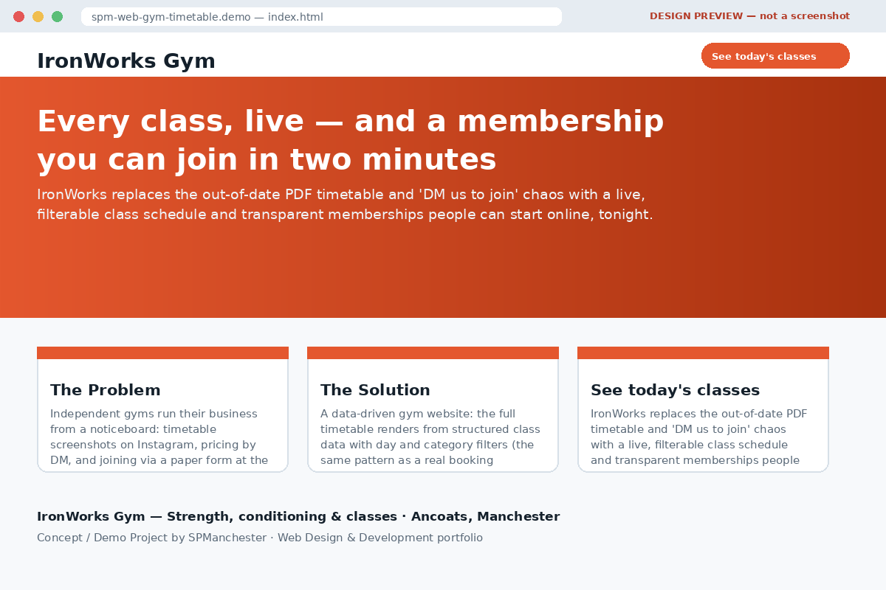
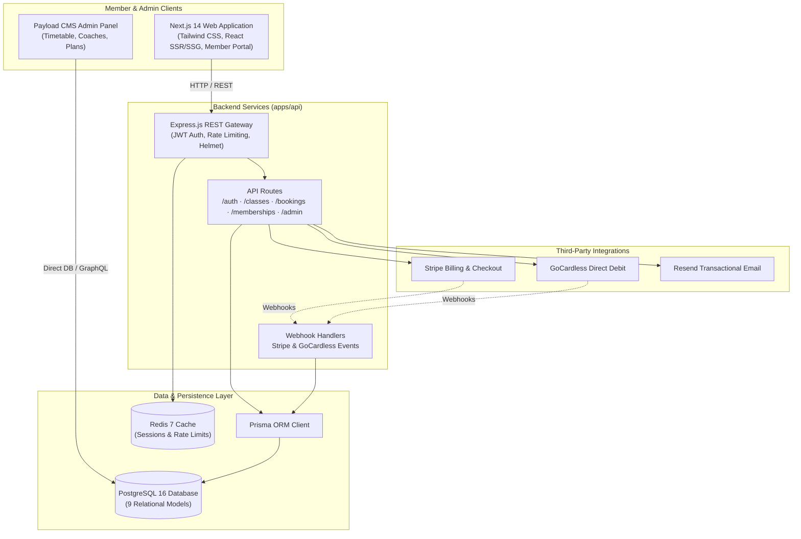

<div align="center">

<a href="https://www.spmanchester.com">
  
</a>

# 🏋️ IronWorks Gym — Live Timetable & Membership Platform

### *Enterprise Full-Stack Architecture for Independent Gyms & Boutique Fitness Studios*

[](https://github.com/serviceprovidermanchester/IronWorks-Gym-Live-Timetable-Membership-Platform/actions)
[](LICENSE)
[](https://nextjs.org/)
[](https://www.typescriptlang.org/)
[](https://www.postgresql.org/)
[](https://www.prisma.io/)
[](https://payloadcms.com/)
[](https://stripe.com/)
[](https://turbo.build/)
[](CONTRIBUTING.md)

<p align="center">
  <strong>Crafted with ❤️ by <a href="https://www.spmanchester.com">SPManchester Private Limited</a></strong><br>
  Lead Architect: <strong>Sayed Mudassar Akbar</strong> · <a href="mailto:info@spmanchester.com">info@spmanchester.com</a>
</p>

[🌐 Official Website](https://www.spmanchester.com) · [📋 Architecture Plan](docs/FULLSTACK-PLAN.md) · [📊 Product Requirements (PRD)](PRD.md) · [⚙️ Tech Spec (TRD)](TRD.md) · [🤝 Contributing](CONTRIBUTING.md) · [🔒 Security](SECURITY.md)

</div>

---

## 📸 Screenshots & Platform Overview

<div align="center">

| Next.js Public Portal & Timetable | Real-Time Admin Operations |
|:---:|:---:|
|  | *Dynamic class scheduling, automated waitlists, Stripe billing* |

</div>

> **Notice:** IronWorks Gym is an enterprise-grade reference architecture and portfolio production system engineered by **SPManchester Private Limited** to demonstrate modern web engineering for independent gyms.

---

## 💡 The Problem & Business Context

Independent and boutique fitness facilities face a critical customer conversion challenge:
- **Noticeboard Operations:** Class timetables shared via Instagram stories and low-res PNG screenshots.
- **High Joining Friction:** New members forced to fill out paper waiver forms or direct message gym owners for pricing.
- **Member Churn:** Budget fitness chains win ready-to-join members purely through frictionless mobile apps and instant checkout.

**IronWorks Gym platform solves this completely:**
Combining boutique fitness character with chain-grade digital infrastructure — real-time class booking with automated waitlist promotion, instant Direct Debit / credit card memberships via Stripe, and full CMS control for gym managers without touching code.

---

## 🏛️ System Architecture



---

## 📦 Monorepo Structure

```
IronWorks-Gym-Live-Timetable-Membership-Platform/
├── apps/
│   ├── api/                    # Express.js REST API + Prisma ORM
│   │   ├── prisma/
│   │   │   ├── schema.prisma   # 9 models: Member, ClassSession, Booking, etc.
│   │   │   └── seed.ts         # 4 coaches, 18 classes, 3 membership plans
│   │   └── src/
│   │       ├── routes/         # auth, classes, coaches, bookings, memberships, webhooks
│   │       ├── middleware/     # JWT authentication, rate limiting, error handler
│   │       └── lib/            # Prisma, Redis, Stripe, Pino logger
│   ├── web/                    # Next.js 14 App Router Frontend
│   │   ├── app/
│   │   │   ├── (public)/       # Timetable, Coaches, Membership
│   │   │   ├── (auth)/         # Login, Register
│   │   │   ├── (member)/       # Dashboard, Bookings, Profile, Billing
│   │   │   └── admin/          # Live Gym Management & Check-In
│   │   └── components/         # Timetable, PlanCards, Navigation, Drawers
│   └── cms/                    # Payload CMS 2.0 (Headless Content Management)
│       └── src/collections/    # Classes, Coaches, Plans, Announcements
├── packages/
│   ├── types/                  # Shared TypeScript definitions (@ironworks/types)
│   └── config/                 # Shared ESLint & tooling configs
├── legacy/v1/                  # Original static concept demo (HTML5/CSS3/JS)
├── docs/                       # Architecture plans and PRD specifications
├── docker-compose.yml          # PostgreSQL 16 + Redis 7 local development
├── pnpm-workspace.yaml         # Turborepo workspace configuration
└── turbo.json                  # Turborepo pipeline caching
```

---

## 🚀 Quick Start Guide

### Prerequisites
- **Node.js:** `>= 20.0.0`
- **pnpm:** `>= 9.0.0` (`npm i -g pnpm`)
- **Docker & Docker Compose** (for PostgreSQL & Redis)

### 1. Clone & Install Dependencies

```bash
git clone https://github.com/serviceprovidermanchester/IronWorks-Gym-Live-Timetable-Membership-Platform.git
cd IronWorks-Gym-Live-Timetable-Membership-Platform
pnpm install
```

### 2. Start Infrastructure Containers

```bash
docker compose up -d
```
*Spins up PostgreSQL on port `5432` and Redis on port `6379`.*

### 3. Initialize Database & Seed Sample Data

```bash
# Generate Prisma Client & Run Migrations
pnpm db:generate
pnpm db:migrate

# Seed 4 Coaches, 18 Classes, 3 Membership Tiers, Admin User
pnpm db:seed
```

### 4. Run Development Servers

```bash
pnpm dev
```

Platform services will be active at:
- **Frontend Web Portal:** [http://localhost:3000](http://localhost:3000)
- **Backend REST API:** [http://localhost:4000/v1](http://localhost:4000/v1)
- **Payload CMS Admin Panel:** [http://localhost:3001/admin](http://localhost:3001/admin)

---

## 🔌 API Reference Highlights

| Method | Endpoint | Description | Auth Required |
|---|---|---|---|
| `POST` | `/v1/auth/register` | Create member account | No |
| `POST` | `/v1/auth/login` | Authenticate & issue JWT cookie/token | No |
| `GET` | `/v1/classes` | List timetable (filter by `day`, `category`) | No |
| `GET` | `/v1/coaches` | List certified coaches and bios | No |
| `GET` | `/v1/memberships/plans` | Fetch membership pricing tiers | No |
| `POST` | `/v1/memberships/checkout` | Create Stripe checkout session | Member |
| `GET` | `/v1/bookings` | List user reservations & waitlist rank | Member |
| `POST` | `/v1/bookings` | Book spot (auto waitlists if full) | Member |
| `DELETE`| `/v1/bookings/:id` | Cancel reservation (promotes next in queue)| Member |
| `POST` | `/v1/webhooks/stripe` | Handle Stripe subscription lifecycle | Stripe Sig |
| `GET` | `/v1/admin/analytics` | MRR, active members, attendance metrics | Admin |

---

## 🛡️ Security & Production Standards

- **Strict Access Control:** Secure HTTP-only JWT cookies with CSRF defense.
- **Input Sanitization:** Express rate-limiting per IP and route.
- **PCI Compliance:** Zero credit card data stored locally; all handled via Stripe Elements & Webhook signatures.
- **Database Safety:** Prisma parameterization preventing SQL injection.

---

## 🏢 About SPManchester Private Limited

**[SPManchester Private Limited](https://www.spmanchester.com)** is a premier software engineering, cloud architecture, and web development agency based in Manchester, United Kingdom. We build mission-critical, enterprise-grade digital platforms for ambitious businesses.

- **Founder & Lead Architect:** Sayed Mudassar Akbar
- **Website:** [www.spmanchester.com](https://www.spmanchester.com)
- **Inquiries & Client Support:** [info@spmanchester.com](mailto:info@spmanchester.com)
- **Services:** Custom Web Applications, Enterprise Cloud Architecture, API Engineering, Modernization.

---

## 📄 License & Intellectual Property

This project is licensed under the **MIT License** — see the [LICENSE](LICENSE) file for complete details.  
Copyright © 2026 **SPManchester Private Limited**. All rights reserved.
